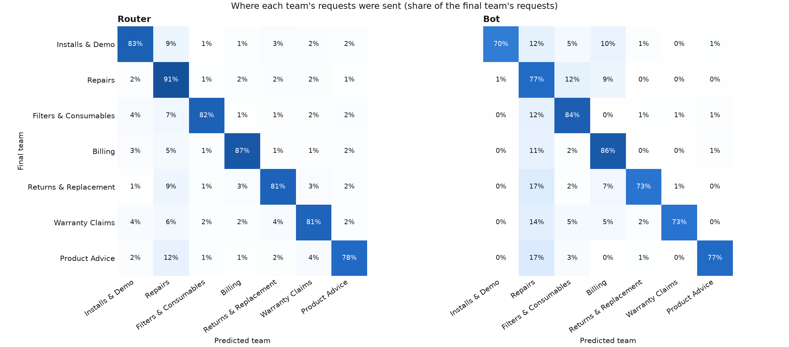
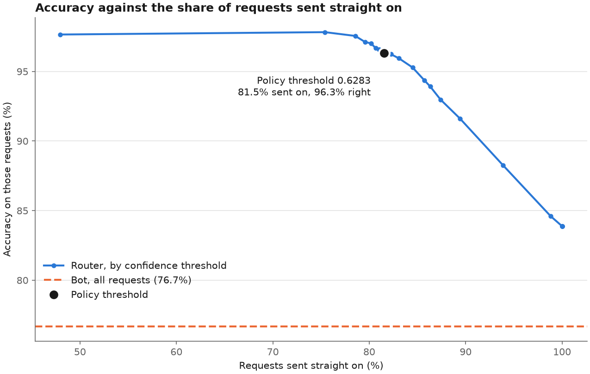
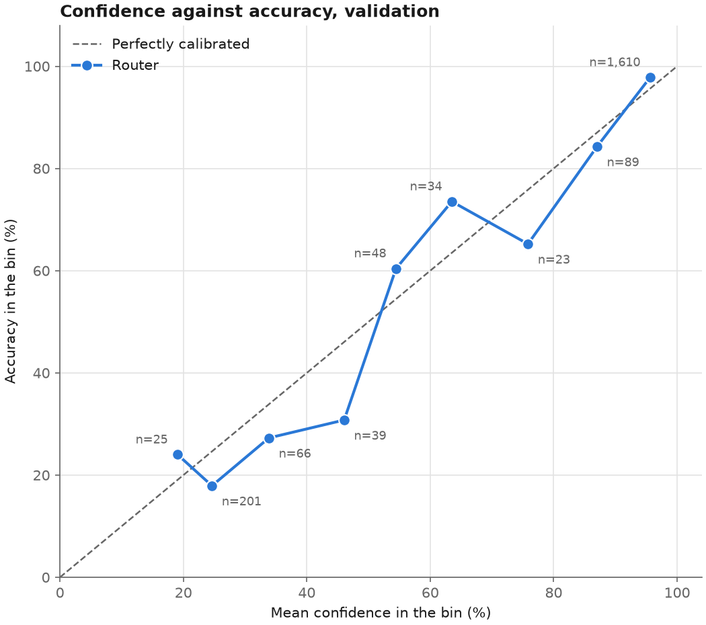
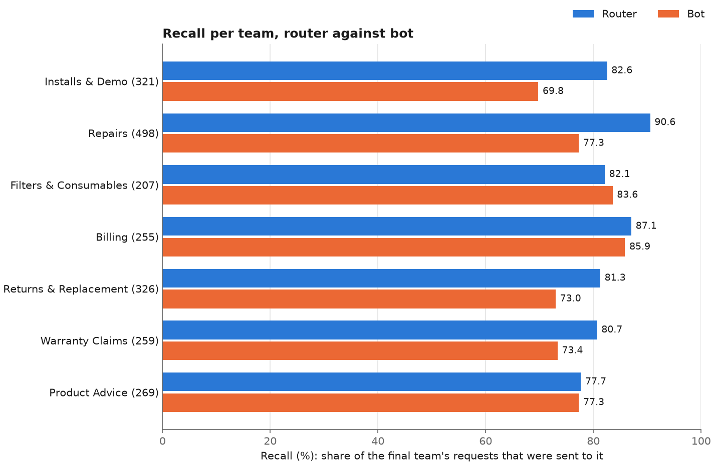

# Evaluation evidence

Model `logreg_c1_none-37d79393afea`, fitted on 8,687 requests (2025-04-01 to 2026-03-31) and scored against the final team on 2,135 validation requests (2026-04-01 to 2026-06-30). Reporting only: nothing was tuned on these numbers. Intervals are bootstrap intervals; repeated messages make them slightly too narrow.

## Headline

| | Accuracy | 95% interval | Macro F-score | Misroutes |
| --- | ---: | --- | ---: | ---: |
| Router | 83.89% | 82.30% to 85.39% | 83.98% | 344 |
| Bot | 76.67% | 74.89% to 78.36% | 77.95% | 498 |

The router is 7.21 points above the bot on the same rows (95% paired interval 5.76 to 8.81). These figures count every request, including those the router would send to triage.

## Per team

| Team | Requests | Router precision | Bot precision | Router recall | Bot recall |
| --- | ---: | ---: | ---: | ---: | ---: |
| Installs & Demo | 321 | 86.04% | 97.39% | 82.55% | 69.78% |
| Repairs | 498 | 77.49% | 62.40% | 90.56% | 77.31% |
| Filters & Consumables | 207 | 88.54% | 60.70% | 82.13% | 83.57% |
| Billing | 255 | 87.40% | 66.16% | 87.06% | 85.88% |
| Returns & Replacement | 326 | 86.32% | 94.44% | 81.29% | 73.01% |
| Warranty Claims | 259 | 82.61% | 95.48% | 80.69% | 73.36% |
| Product Advice | 269 | 87.45% | 94.12% | 77.70% | 77.32% |

Where the bot is better: Installs & Demo precision, Filters & Consumables recall, Returns & Replacement precision, Warranty Claims precision, Product Advice precision.

## Figures

Reliability uses 10 equal-width bins. Mean confidence 83.22% against 83.89% accuracy; expected calibration error 3.35%. Bins with few requests are noisy.

| Confidence from | to | Requests | Mean confidence | Accuracy |
| ---: | ---: | ---: | ---: | ---: |
| 0.1 | 0.2 | 25 | 19.06% | 24.00% |
| 0.2 | 0.3 | 201 | 24.63% | 17.91% |
| 0.3 | 0.4 | 66 | 33.86% | 27.27% |
| 0.4 | 0.5 | 39 | 46.05% | 30.77% |
| 0.5 | 0.6 | 48 | 54.45% | 60.42% |
| 0.6 | 0.7 | 34 | 63.50% | 73.53% |
| 0.7 | 0.8 | 23 | 75.83% | 65.22% |
| 0.8 | 0.9 | 89 | 87.02% | 84.27% |
| 0.9 | 1.0 | 1,610 | 95.63% | 97.83% |

## Breakdowns

| Channel | Requests | Router accuracy | Bot accuracy | Lead, points | Triage rate |
| --- | ---: | ---: | ---: | ---: | ---: |
| chat | 670 | 84.93% | 78.81% | 6.12 | 17.76% |
| email | 228 | 84.21% | 74.56% | 9.65 | 17.11% |
| ivr | 579 | 82.56% | 74.61% | 7.94 | 18.31% |
| whatsapp | 658 | 83.89% | 77.05% | 6.84 | 19.76% |

| Month | Requests | Router accuracy | Bot accuracy | Lead, points | Triage rate |
| --- | ---: | ---: | ---: | ---: | ---: |
| 2026-04 | 697 | 85.08% | 78.91% | 6.17 | 16.93% |
| 2026-05 | 734 | 84.33% | 76.98% | 7.36 | 17.98% |
| 2026-06 | 704 | 82.24% | 74.15% | 8.10 | 20.45% |

| Warranty status | Requests | Router accuracy | Bot accuracy | Lead, points | Triage rate |
| --- | ---: | ---: | ---: | ---: | ---: |
| in_warranty | 1,150 | 83.48% | 76.87% | 6.61 | 18.78% |
| out_of_warranty | 532 | 83.83% | 75.94% | 7.89 | 19.55% |
| shield | 453 | 84.99% | 77.04% | 7.95 | 16.34% |

| Text in train window | Requests | Router accuracy | Bot accuracy | Lead, points | Triage rate |
| --- | ---: | ---: | ---: | ---: | ---: |
| seen | 213 | 84.98% | 80.28% | 4.69 | 15.96% |
| unseen | 1,922 | 83.77% | 76.27% | 7.49 | 18.73% |

Seen means the same cleaned text occurs in the train window: 9.98% of validation, 10.15% of test.

## Triage

| | Requests | Accuracy | Misroutes |
| --- | ---: | ---: | ---: |
| Sent straight on | 1,741 | 96.32% | 64 |
| Triaged | 394 | 28.93% | 280 |
| All | 2,135 | 83.89% | 344 |

- 18.45% of requests are triaged (confidence below 0.6283, from policy costs, not tuned). Their mean confidence is 32.96%.
- Vague requests (M2 rule): 173 of 173 triaged (100.00%).

## Rupees per month

| Case | Rs per month |
| --- | ---: |
| Router with triage, clarification always works (best case) | 49,039 |
| Router without triage | 80,044 |
| Router with triage, clarification fixes nothing (worst case) | 114,191 |
| Bot, same requests | 115,878 |
| Bot licence, separate and not included above | 26,667 |

- Best-case saving against the bot: Rs 66,839 per month. If clarification fixes nothing the gap is only Rs 1,687 per month. Both leave the licence out.
- Break-even clarification rate 52.41%: triage beats no triage only if a question settles more than this share of the triaged misroutes. The data does not say how often it does; ask operations.

Assumptions:

- Rs 698.06 per misroute: Rs 305 per transfer times the average transfers per misrouted request, plus Rs 260 for the extra contact (§4). The average covers all 15 labelled months, validation included.
- The triage threshold uses the train-window figure instead, Rs 699.49.
- Our misroutes are assumed to bounce as often as the bot's did.
- One clarifying contact costs Rs 260, the same as an extra customer contact.
- Validation covers 3 months; totals are divided by that.
- The licence is Rs 320,000 per year. The cost of running the router and agent time beyond the contact are not in the data and not included.

## When it fails

344 of 2,135 requests are misrouted (16.11%); 64 of them are sent straight on. The right team is among the top three in 150.

Categories overlap, except in the last column, where each misroute counts once in the first category that fits.

| Category | Requests | Misroutes | Misroute rate | Sent straight on and wrong | Misroutes counted once |
| --- | ---: | ---: | ---: | ---: | ---: |
| Vague request (M2 rule) | 173 | 136 | 78.61% | 0 | 136 |
| Close call between two teams | 241 | 193 | 80.08% | 0 | 94 |
| Text names another product than the request field | 339 | 71 | 20.94% | 15 | 29 |
| IVR transcript | 579 | 101 | 17.44% | 24 | 23 |
| None of these | 1,142 | 62 | 5.43% | 33 | 62 |

A close call is a gap of at most 0.10 between the first and second probability. A category is a description, not a proven cause: compare its misroute rate with the overall one.

Router phrases seen most on these misroutes, with the number of misroutes (at most 3 words, only phrases found in at least 10 different train messages, §10):

- Vague request (M2 rule): 'mixer' (18); 'service request' (14); 'heater' (12); 'need help' (11); 'someone contact' (11).
- Close call between two teams: 'not happy' (11); 'vacuum' (10); 'water purifier' (8); 'purifier' (7); 'service request' (7).
- Text names another product than the request field: 'box' (7); 'open' (4); 'scratched' (4); 'missing parts' (3); 'paid' (3).
- IVR transcript: 'return' (3); 'warranty' (3); 'between lite' (2); 'cancel' (2); 'issue' (2).
- None of these: 'order' (7); 'not happy' (5); 'paid' (5); 'warranty' (5); 'water purifier' (5).

## Expected hidden-test score

**If hidden labels are the final team: 83.89%, range 80.74% to 86.01%** (macro F-score on validation 83.98%). Accuracy is assumed to be the metric, and every request is scored on the router's first choice, triaged or not.

- Validation interval (95%): 82.30% to 85.39%. Its half-widths are multiplied by the square root of two (1.4142), because the test score is itself a sample of similar size.
- Time drift: accuracy was 84.78% on the earlier inner validation window, 0.89 points higher. That much is taken off the low end only. The inner model was fitted on fewer months, so this is a rough allowance.
- The router and the bot both decline over the three months, while the router's lead over the bot stays roughly constant within sampling noise: 6.17, 7.36, 8.10 points; the paired intervals all overlap, although the point estimates rise every month, so the lead is not shrinking.
- Retraining on all 15 months: not measured, because M6 fits no new model, so nothing is added for it.
- Vague ceiling: 8.13% of test messages are vague (M2 rule), and the router gets 21.39% of vague validation messages right. Even with every other request right, accuracy would be about 93.61%.
- The validation score is not untouched: the configuration is the M4 baseline, already scored on validation, and M5a's selection rule was amended after a validation result had been seen. The range is a judgement, not a guarantee.

| Month | Router accuracy | Bot accuracy | Lead, points | Paired interval, points |
| --- | ---: | ---: | ---: | --- |
| 2026-04 | 85.08% | 78.91% | 6.17 | 3.73 to 8.61 |
| 2026-05 | 84.33% | 76.98% | 7.36 | 4.77 to 10.35 |
| 2026-06 | 82.24% | 74.15% | 8.10 | 5.54 to 10.80 |

**If hidden labels are the bot's `team_label` instead: 80.52%, range 78.20% to 83.03%** (interval 78.87% to 82.30%, macro F-score 81.03%). This is the router's agreement with the bot on validation, with the same widening. The bot itself would score perfectly by construction, so this score would reward copying its mistakes.

## Consistency with earlier reports

All 95 comparisons match within the tolerance in `evaluation.json`; the build stops otherwise. Keys are in the JSON form of each report. The per-team rows are in the JSON only.

| This report | Value | Source | Source key |
| --- | ---: | --- | --- |
| headline > router > accuracy | 0.838876 | baselines.json | baselines > tfidf_final > evaluate > accuracy |
| headline > router > accuracy | 0.838876 | experiments.json | real_val > logreg_c1_none > accuracy |
| headline > router > accuracy | 0.838876 | router.json | accuracy > all |
| headline > router > macro_f1 | 0.839821 | baselines.json | baselines > tfidf_final > evaluate > macro_f1 |
| headline > router > macro_f1 | 0.839821 | experiments.json | real_val > logreg_c1_none > macro_f1 |
| headline > router > misroutes | 344 | baselines.json | baselines > tfidf_final > evaluate > misroutes |
| headline > router > misroutes | 344 | router.json | misroutes > all |
| headline > bot > accuracy | 0.766745 | baselines.json | baselines > bot > evaluate > accuracy |
| headline > bot > accuracy | 0.766745 | experiments.json | bot_real_val_accuracy |
| headline > bot > accuracy | 0.766745 | router.json | accuracy > bot |
| headline > bot > macro_f1 | 0.779507 | baselines.json | baselines > bot > evaluate > macro_f1 |
| headline > bot > misroutes | 498 | baselines.json | baselines > bot > evaluate > misroutes |
| headline > bot > misroutes | 498 | router.json | misroutes > bot |
| headline > rows | 2135 | router.json | validation > rows |
| headline > router > accuracy_ci95 > low | 0.822951 | baselines.json | baselines > tfidf_final > accuracy_ci95 > low |
| headline > router > accuracy_ci95 > low | 0.822951 | experiments.json | real_val > logreg_c1_none > accuracy_ci95 > low |
| headline > bot > accuracy_ci95 > low | 0.748946 | baselines.json | baselines > bot > accuracy_ci95 > low |
| headline > paired_accuracy_points_router_minus_bot > low | 5.759953 | baselines.json | paired_accuracy_points_tfidf_final_minus_bot > low |
| headline > paired_accuracy_points_router_minus_bot > low | 5.759953 | experiments.json | real_val > logreg_c1_none > paired_accuracy_points_minus_bot > low |
| headline > router > accuracy_ci95 > point | 0.838876 | baselines.json | baselines > tfidf_final > accuracy_ci95 > point |
| headline > router > accuracy_ci95 > point | 0.838876 | experiments.json | real_val > logreg_c1_none > accuracy_ci95 > point |
| headline > bot > accuracy_ci95 > point | 0.766745 | baselines.json | baselines > bot > accuracy_ci95 > point |
| headline > paired_accuracy_points_router_minus_bot > point | 7.213115 | baselines.json | paired_accuracy_points_tfidf_final_minus_bot > point |
| headline > paired_accuracy_points_router_minus_bot > point | 7.213115 | experiments.json | real_val > logreg_c1_none > paired_accuracy_points_minus_bot > point |
| headline > router > accuracy_ci95 > high | 0.853864 | baselines.json | baselines > tfidf_final > accuracy_ci95 > high |
| headline > router > accuracy_ci95 > high | 0.853864 | experiments.json | real_val > logreg_c1_none > accuracy_ci95 > high |
| headline > bot > accuracy_ci95 > high | 0.783618 | baselines.json | baselines > bot > accuracy_ci95 > high |
| headline > paired_accuracy_points_router_minus_bot > high | 8.805621 | baselines.json | paired_accuracy_points_tfidf_final_minus_bot > high |
| headline > paired_accuracy_points_router_minus_bot > high | 8.805621 | experiments.json | real_val > logreg_c1_none > paired_accuracy_points_minus_bot > high |
| triage > count | 394 | router.json | triage > count |
| triage > rate | 0.184543 | router.json | triage > rate |
| triage > sent_count | 1741 | router.json | triage > sent_count |
| triage > mean_confidence_triaged | 0.329629 | router.json | triage > mean_confidence |
| triage > accuracy_sent | 0.963240 | router.json | accuracy > sent |
| triage > accuracy_triaged | 0.289340 | router.json | accuracy > triaged |
| triage > misroutes_sent | 64 | router.json | misroutes > sent |
| triage > misroutes_triaged | 280 | router.json | misroutes > triaged |
| triage > threshold | 0.628301 | router.json | router > threshold |
| triage > vague_count | 173 | router.json | vague > count |
| triage > vague_triaged_count | 173 | router.json | vague > triaged_count |
| coverage_curve > policy_point > accuracy_on_covered | 0.963240 | router.json | accuracy > sent |
| costs > per_month_rs > router_clarification_always_works | 49038.602455 | router.json | cost_per_month_rs > router |
| costs > per_month_rs > router_without_triage | 80044.154863 | router.json | cost_per_month_rs > router_without_triage |
| costs > per_month_rs > router_without_triage | 80044.154863 | baselines.json | baselines > tfidf_final > cost_rs_per_month |
| costs > per_month_rs > router_clarification_fixes_nothing | 114190.821530 | router.json | cost_per_month_rs > router_if_clarification_fixes_nothing |
| costs > per_month_rs > bot | 115877.875354 | router.json | cost_per_month_rs > bot |
| costs > per_month_rs > bot | 115877.875354 | baselines.json | baselines > bot > cost_rs_per_month |
| costs > per_month_rs > bot_licence | 26666.666667 | router.json | cost_per_month_rs > bot_licence |
| costs > per_month_rs > bot_licence | 26666.666667 | baselines.json | meta > bot_licence_rs_per_month |
| costs > bot_minus_router_rs | 66839.272899 | router.json | cost_per_month_rs > bot_minus_router |
| costs > break_even_clarification_rate | 0.524106 | router.json | break_even_clarification_rate |
| costs > inputs > cost_per_misroute_rs | 698.059490 | router.json | cost_per_misroute_reporting |
| expected_score > bot_label > point | 0.805152 | baselines.json | baselines > tfidf_final > agreement_with_team_label |
| expected_score > final_team > inner_val_accuracy | 0.847786 | experiments.json | supplementary > base_inner_val > accuracy |
| seen_text > test_seen_share | 0.101469 | baselines.json | repeated_text > test_seen_share |
